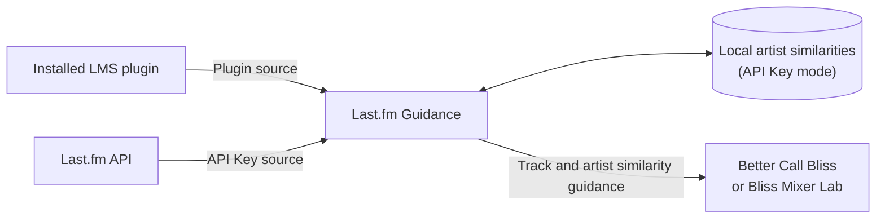

# Bliss Guidance: Last.fm

**Bring Last.fm's music knowledge into your Bliss mixes.**

**Bliss Guidance: Last.fm** is an optional plugin for [Lyrion Music Server (LMS)](https://lyrion.org/) that contributes Last.fm **similar-track** and **similar-artist** information to [Better Call Bliss](https://github.com/chrober/lms-better-call-bliss) and [Bliss Mixer Lab](https://github.com/chrober/lms-blissmixer-lab).

**Bliss-first by design:** The host first uses Bliss acoustic similarity to identify suitable candidate tracks. Only then does Last.fm Guidance influence how those already eligible tracks are ranked. It cannot introduce new candidates or override repeat rules. This differs from [LastMix](https://github.com/michaelherger/LastMix), which can create mixes based on Last.fm recommendations. Last.fm Guidance contributes **additional guidance** rather than creating mixes or controlling playback by itself.

As an extra benefit, you can store Last.fm **artist similarity** information locally for offline-friendly listening, such as running Lyrion on a Raspberry Pi while travelling.

## What can I do with it?

### Discover musically related tracks and artists

*"I want Bliss to consider more than how two recordings sound."*

Use Last.fm **similar-track** and **similar-artist** relationships as additional evidence when a compatible Bliss plugin chooses music. This can help the host favor tracks that are related according to Last.fm while remaining within the selection already allowed by Bliss.

### Add another perspective to Don't Stop the Music

*"I enjoy Bliss-based automatic mixes, but I'd like Last.fm's artist and track relationships to influence what plays next."*

Enable the Last.fm provider in **Bliss Mixer Lab** and let it contribute to the Lab's separate **Bliss (Lab)** DSTM provider.

### Guide playlist and player-queue optimization

*"I'm improving a playlist with Better Call Bliss and want to use related-music information as well as acoustic similarity."*

Enable the provider in **Better Call Bliss** to add Last.fm evidence to its route and playlist scoring, subject to the host's supported settings and eligibility rules.

### Keep artist relationships available when offline

*"I take my Raspberry Pi music server with me and won't always have an internet connection."*

With the **API Key** source, you can download artist similarity information for your library while connected to the internet and retain it locally. **Offline preferred** can then use previously stored artist relationships when remote access is unavailable. This is a secondary feature, not a prerequisite for using the provider.

## Key features

- **Similar-track guidance:** Last.fm's recording-level relationships can influence the host's selection.
- **Similar-artist guidance:** Artist relationships offer a complementary view of musical similarity.
- **Two sources:** Reuse information from the separately installed **[LastMix](https://github.com/michaelherger/LastMix)** plugin, or query Last.fm directly with an **API Key**.
- **Local artist-similarity library:** With the API Key source, fetch and store artist relationships for use across sessions, including offline-preferred use.
- **Background updates and maintenance:** Inspect artist-graph coverage, update locally stored data, pause/resume or cancel updates, compact storage, or delete the graph with confirmation.
- **Host-controlled guidance:** Each compatible Bliss host discovers the provider but keeps it disabled until you enable it.
- **Graceful fallback:** Missing Last.fm information, API errors, rate limits, or loss of network access do not prevent Bliss-only music selection.

## How it fits into the Bliss ecosystem

| Component | What it contributes | Required? |
| --- | --- | --- |
| [Bliss Mixer](https://github.com/CDrummond/lms-blissmixer) | Acoustic library analysis (`bliss.db`) and base mixing preferences for the compatible hosts | Required by host; not by this provider directly |
| [Better Call Bliss](https://github.com/chrober/lms-better-call-bliss) | Playlist and player-queue optimization that can use Last.fm guidance | One of the two compatible hosts |
| [Bliss Mixer Lab](https://github.com/chrober/lms-blissmixer-lab) | Experimental **Bliss (Lab)** Don't Stop the Music mixes that can use Last.fm guidance | One of the two compatible hosts |
| [Library Signals](https://github.com/chrober/lms-guidance-library-signals) | Separate optional guidance from play counts, last-played dates, and library age | No |
| **Last.fm Guidance** | Additional similar-track and similar-artist evidence for already Bliss-eligible candidates | This plugin |

Install **Better Call Bliss**, **Bliss Mixer Lab**, or both, and enable Last.fm Guidance on each host's settings page where you want to use it. The provider never creates mixes on its own; candidate eligibility, acoustic similarity, and hard repeat constraints remain under the host's control.

## Choose your Last.fm source

Select one source on the plugin's settings page:

| Source | Best when you want to… | Requirements |
| --- | --- | --- |
| **[LastMix](https://github.com/michaelherger/LastMix)** | Reuse Last.fm similarity information from an existing [LastMix](https://github.com/michaelherger/LastMix) setup | [LastMix](https://github.com/michaelherger/LastMix) must be installed; the source is unavailable otherwise |
| **API Key** | Access Last.fm directly, maintain a local artist-similarity library, and use offline-preferred retrieval | A valid Last.fm API key |

In **[LastMix](https://github.com/michaelherger/LastMix)** mode, the Lyrion provider obtains observations through [LastMix](https://github.com/michaelherger/LastMix); the host resolves them to the local candidate inventory. In **API Key** mode, the native provider fetches only the needed source relationships during preparation, stores artist relations locally, and then scores candidates without further network requests for that job.

For API Key mode, you can select an API key configured directly in this provider or an existing **custom** API key saved in [LastMix](https://github.com/michaelherger/LastMix). [LastMix](https://github.com/michaelherger/LastMix) does not have to be enabled merely to reuse its saved custom key. Its custom-key checkbox and shared secret are not required. The selected key must exist; a missing key does not silently fall back to another one. If both plugins use the same key, they also share its request limits.

## Requirements

- **Lyrion Music Server:** Developed and tested with **Lyrion 9.1**. Older versions may also work, but have not been tested.
- **Compatible host:** [Better Call Bliss](https://github.com/chrober/lms-better-call-bliss) or [Bliss Mixer Lab](https://github.com/chrober/lms-blissmixer-lab), installed and enabled. Enable Last.fm Guidance separately on the **host plugin's settings page**; installing the provider alone does not affect music selection.
- **Last.fm data source:** Choose either **[LastMix](https://github.com/michaelherger/LastMix)** (the [LastMix](https://github.com/michaelherger/LastMix) plugin must be installed and enabled) or **API Key** (a valid Last.fm API key is needed). An existing custom key saved in [LastMix](https://github.com/michaelherger/LastMix) can also be reused in API Key mode without enabling [LastMix](https://github.com/michaelherger/LastMix).
- **Native binary:** A compatible `bliss-guidance-lastfm` executable. Official plugin-feed packages include binaries for Windows, macOS, x86_64 Linux, ARM64 Linux, and ARMHF Linux.
- **Network access:** Needed to fetch Last.fm information that is not already cached. Previously stored artist-similarity data can also be used with the offline-preferred policy when offline.

Last.fm Guidance itself does **not** require a [Bliss Mixer](https://github.com/CDrummond/lms-blissmixer) installation, a `bliss.db`, or a separate Bliss analysis. Those may be required by the chosen host plugin. You do not need both [LastMix](https://github.com/michaelherger/LastMix) and a separately configured API key; choose the source that fits your setup.

## Installation

1. Make sure your compatible Bliss host is installed and working.
2. In **LMS Settings > Plugins**, add this repository if it is not already present:

   ```text
   https://raw.githubusercontent.com/chrober/lms-plugins/main/repo.xml
   ```

3. Install **Bliss Guidance: Last.fm** and restart LMS if requested.
4. Open the provider's settings page and choose **[LastMix](https://github.com/michaelherger/LastMix)** or **API Key**. Configure the selected source.
5. On the **settings page of [Better Call Bliss](https://github.com/chrober/lms-better-call-bliss) or [Bliss Mixer Lab](https://github.com/chrober/lms-blissmixer-lab)**, **enable the Last.fm guidance provider**. It is disabled by default in each host.

## Getting started

To try Last.fm guidance in an ordinary online listening session:

1. Select **[LastMix](https://github.com/michaelherger/LastMix)** (if you use [LastMix](https://github.com/michaelherger/LastMix)) or **API Key** in the provider settings.
2. Save the source configuration and adjust any guidance defaults you want to use.
3. On your chosen compatible host's **settings page**, enable Last.fm guidance; review any host-specific overrides.
4. Start a **Bliss (Lab)** DSTM session or preview a playlist/queue optimization in **Better Call Bliss**.
5. Compare results with and without Last.fm guidance. It is one influence on candidate selection, not a guarantee that any particular artist or track will appear.

## Optional: keep artist similarities for offline listening

The API Key source supports a local, provider-owned SQLite **artist-similarity graph**. It is useful on a server that sometimes loses internet access—for example, a Raspberry Pi taken on a trip—but does not change the provider's primary purpose of guiding music selection.

### Prepare an offline-friendly library

1. Choose **API Key** and configure a valid API key while connected to the internet.
2. On the Last.fm provider settings page, choose the desired graph scope, artist result count, and refresh policy.
3. Click **Update offline Last.fm library** to collect similar-artist information for the artists in your local Lyrion library.
4. Monitor the displayed coverage, progress, requests, and storage usage. Updates can be paused, resumed, or cancelled.
5. Select **Offline preferred** for listening where the network might be unavailable, and make sure Last.fm guidance is enabled in the host you plan to use.

### What works offline—and what doesn't?

- **Artist similarities:** Previously stored relationships can be used without an active internet connection, subject to availability and the selected retrieval policy.
- **Track similarities:** These use a separate, short-lived JSON cache; they are **not** stored permanently in the SQLite artist graph. Do not assume all track similarities will be available offline.
- **Missing or expired data:** The provider degrades gracefully to partial or neutral guidance instead of blocking a Bliss result.
- **Offline preferred is not strict offline-only:** The public settings expose **Online with cache** and **Offline preferred**. A strict offline-only mode is reserved for controlled testing, not a supported user-interface option under the current Last.fm terms.
- **[LastMix](https://github.com/michaelherger/LastMix) mode:** Does not use, populate, maintain, or report the API Key source's offline SQLite graph.

### Local graph management

The settings page shows graph coverage, physical SQLite footprint, and a separate estimate of retained Last.fm data. Maintenance controls include updating artist information, pausing/resuming or cancelling an update, cleaning up and compacting stored data, and confirmed deletion.

**Clean up and compact stored data** refreshes its local view of your library, repairs unambiguous encoding errors, removes unused relationships, and compacts storage without sending Last.fm requests. Ambiguous repairs are left untouched. This operation can remove stored data and therefore requires confirmation.

### Refresh and storage limits

- Optional refresh targets govern when results and empty results are checked again. With the fields empty, Last.fm freshness headers are used where available, falling back to **30 days for results** and **7 days for empty results**.
- A custom refresh target affects manual updates and direct guidance preparation; it **does not schedule periodic updates**.
- The default retained-data budget is **100 decimal MB**. It applies to a defined representation of retained Last.fm data rather than simply the physical size of the SQLite file. Track-result value data in the separate JSON cache also contributes to the budget.
- Last.fm's [API terms](https://www.last.fm/api/tos) require prior written consent to exceed its **100 MB reasonable-usage cap**. The plugin's displayed accounting is an estimate, **not a compliance certification**.
- The cache supports HTTP revalidation but does not yet interpret every cache directive. Concurrent writers may race between separate budget checks.

## Configuration and limitations

- Host settings inherit the provider defaults unless that host overrides a supported policy.
- In **API Key** mode, remote requests happen during **prepare**, never during **score**. Scoring uses frozen evidence for the current job and performs no network I/O.
- Existing data, failed lookups, timeouts, rate limits, and invalid responses may leave only partial Last.fm guidance; the host can continue with Bliss-only selection.
- API keys are supplied to the native child process through its environment and are not included in the host's request JSON, intermediate artifacts, logs, or previews.
- Normal form **Save** is explicit. Graph maintenance buttons do not save unrelated unsaved settings edits.

## Technical details

The native implementation is [`bliss-guidance-lastfm`](https://github.com/chrober/bliss-guidance-lastfm). The common provider protocol is [`bliss-playlist-guidance-spi`](https://github.com/chrober/bliss-playlist-guidance-spi), with Lyrion conventions documented in [`lms-bliss-guidance-provider-kit`](https://github.com/chrober/lms-bliss-guidance-provider-kit).

### Architecture



Last.fm Guidance gets related-track and related-artist information either through [LastMix](https://github.com/michaelherger/LastMix) or directly from the Last.fm API. With the API Key source, artist similarities can also be stored locally. Better Call Bliss or Bliss Mixer Lab uses this extra guidance to rank tracks already selected as eligible by Bliss; only those host plugins create mixes or change playlists and queues.

### Offline graph maintenance internals

The **Update offline Last.fm library** action snapshots distinct contributors from the local Lyrion library, including available MusicBrainz artist IDs, then starts native synchronization asynchronously. The update reports per-artist progress, request/cache/change counts, pauses, errors, timing, and completion without requiring a settings-page reload.

Local-only artist scope checks current library membership before retaining matches; a background membership refresh keeps the graph aligned with newly added artists. If local membership cannot be read, affected local-only results are not persisted against stale membership.

The native implementation supports trusted `graph status`, `graph sync`, `graph compact`, and `graph delete` commands using a request file. It rate-limits acquisition, commits usable completed results, and can resume partial progress. See the [native provider README](https://github.com/chrober/bliss-guidance-lastfm) for exact command syntax and the storage and identity model.

## License and credits

This project relies on Last.fm's API and its [terms of service](https://www.last.fm/api/tos). See the individual component repositories for applicable licenses and credits, including [Bliss Mixer](https://github.com/CDrummond/lms-blissmixer).
