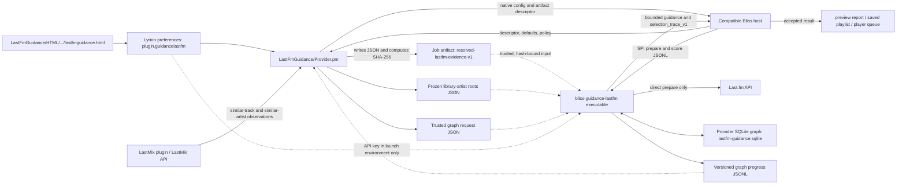
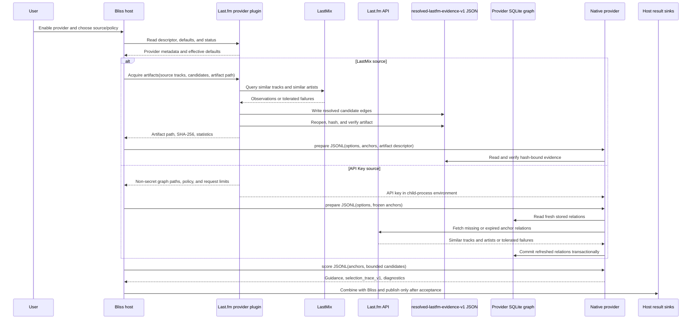
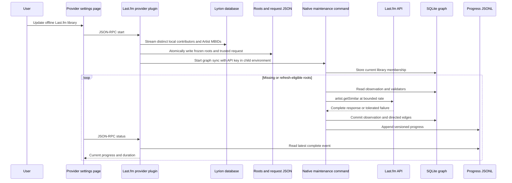

# Bliss Guidance: Last.fm

`lms-guidance-lastfm` is an independently installable, passive Lyrion guidance
provider in the **Bliss Guidance** family. It contributes bounded Last.fm
similar-track and similar-artist evidence when a compatible Bliss host invokes
it. It does not create mixes, reorder tracks, or control playback by itself;
another plugin must discover, enable, and use it.

## How it works

Choose one provider-owned source on its settings page:

- **LastMix** uses the installed LastMix plugin and remains unavailable until that plugin is installed.
- **API Key** lets the native provider acquire and persist Last.fm relations
  during SPI preparation. The key is passed only through the child-process
  environment; it never enters request JSON, artifacts, logs, or preview
  results.

With **LastMix**, the Lyrion provider obtains observations, the host resolves
them to the frozen local candidate inventory, and the native provider consumes
the resulting artifact. With **API Key**, the native provider queries only the
frozen source anchors during `prepare`, persists complete observations in its
SQLite graph, and then
scores the host's Bliss-qualified candidate batches without network access.

Hosts discover the provider automatically but default it to disabled. Their
provider settings use these defaults unless a host explicitly overrides an
eligible policy control.

The compatible host plugins currently include
[Better Call Bliss](https://github.com/chrober/lms-better-call-bliss) and
[Bliss Mixer Lab](https://github.com/chrober/lms-blissmixer-lab). Both discover
this provider but leave it disabled until you explicitly enable it.

The native implementation is
[`bliss-guidance-lastfm`](https://github.com/chrober/bliss-guidance-lastfm).
The native protocol is owned by
[`bliss-playlist-guidance-spi`](https://github.com/chrober/bliss-playlist-guidance-spi).
Provider conventions and UI rules are documented in
[`lms-bliss-guidance-provider-kit`](https://github.com/chrober/lms-bliss-guidance-provider-kit).

## Architecture

The provider-owned files and streams are:

- `LastFmGuidance/Plugin.pm` exposes the discoverable provider, while
  `LastFmGuidance/Settings.pm` registers its settings page.
- `LastFmGuidance/HTML/EN/plugins/LastFmGuidance/settings/lastfmguidance.html`
  renders that page; persisted values live in the Lyrion
  `plugin.guidancelastfm` preference namespace.
- `LastFmGuidance/Provider.pm` publishes the descriptor and defaults, resolves
  host/job overrides, calls LastMix in LastMix mode, and writes the temporary
  `resolved-lastfm-evidence-v1` JSON artifact supplied by the host. In API-key
  mode it instead supplies only provider-owned graph paths and non-secret
  request limits plus the launch-only environment variable.
- `bliss-guidance-lastfm` reads that artifact and the bounded candidate/context
  messages from SPI JSONL on stdin, then returns bounded guidance,
  `selection_trace_v1`, and diagnostics on stdout. There is no separate
  `prepare.options` file: native options are part of the SPI `prepare` message.
- The host consumes the response and is the only component that writes preview
  results, playlists, or player queues.

## Runtime flow

In **API Key** mode no LastMix artifact is created. Remote requests are limited
to `prepare`; `score` is deterministic for the prepared session and performs no
network I/O. Missing graph entries, invalid responses, rate limits, timeouts, and
offline operation degrade to partial or neutral guidance rather than blocking
the Bliss result.

## Offline artist graph and manual update

When **API Key** is selected, the settings page also owns the offline graph
policy, storage scope, and the number of similar artists requested per source.
It shows graph coverage, physical SQLite storage, and the separately accounted
retained Last.fm data size, and can start a full library-artist update.
The update:

- snapshots distinct local Lyrion contributors with their available Artist
  MBIDs;
- runs native synchronization asynchronously, with the API key present only in
  the child environment;
- reports start time, duration, current/total artists, request/cache/change
  counts, rate-limit pauses, errors, and completion without reloading the
  settings page; and
- supports pause/resume, cancellation, compaction, and confirmed deletion.

The 80 MiB safety budget applies to canonical Last.fm artist-similarity data
kept in SQLite: returned artist identities, ranks, scores, and HTTP validators.
Track similarities may use the separate short-lived JSON cache but are never
persisted in SQLite. SQLite pages, indexes, WAL/SHM files, and Lyrion-owned
membership metadata are not treated as Last.fm data. The settings page displays
both the logical retained-data total and the physical SQLite footprint.

Normal **Save** remains explicit. Maintenance buttons never persist unrelated
unsaved form edits. Graph controls are hidden for **LastMix**, and that path
does not open, populate, migrate, compact, delete, or report the graph.

The public settings intentionally expose **Online with cache** and **Offline
preferred**. A strict native offline-only policy exists for controlled testing,
but is not offered in the plugin UI until the applicable Last.fm terms permit
shipping it as a supported user mode.

## Logging

The plugin registers the `plugin.guidancelastfm` log category. At information
level it reports similar-track and similar-artist requests, result counts,
cache use, tolerated failures, and preparation summaries. Debug level adds
sanitized request/response JSON, returned track or artist relations, and
candidate-scoring coverage. Fatal provider or host startup failures remain in
the calling host's error log because no provider session exists to report them.

LastMix acquisition logs directly through this category. API Key acquisition
and native scoring return structured events through
`guidance_log_event_v1`; the host transports them back to this plugin for the
same provider-owned rendering. API keys and signatures are always redacted.

## Installation

Install **Bliss Guidance: Last.fm** through
[chrober's LMS Plugin Repository](https://github.com/chrober/lms-plugins), then
enable the provider in a compatible host. Install and configure LastMix
separately when you want to use the LastMix source.

Configure the source and provider-owned guidance defaults on the provider's
own settings page. Compatible hosts may save their own source and guidance
overrides; the API key itself always remains private to this provider.
